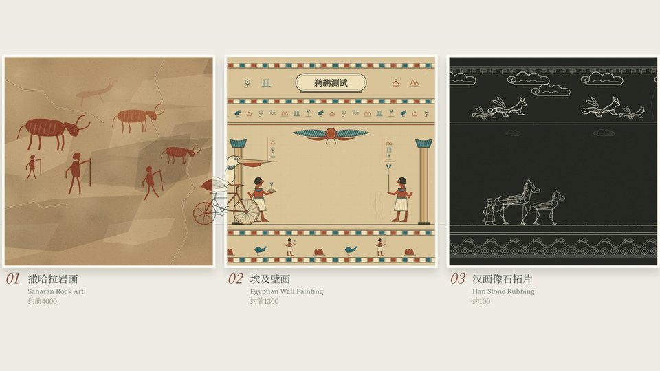
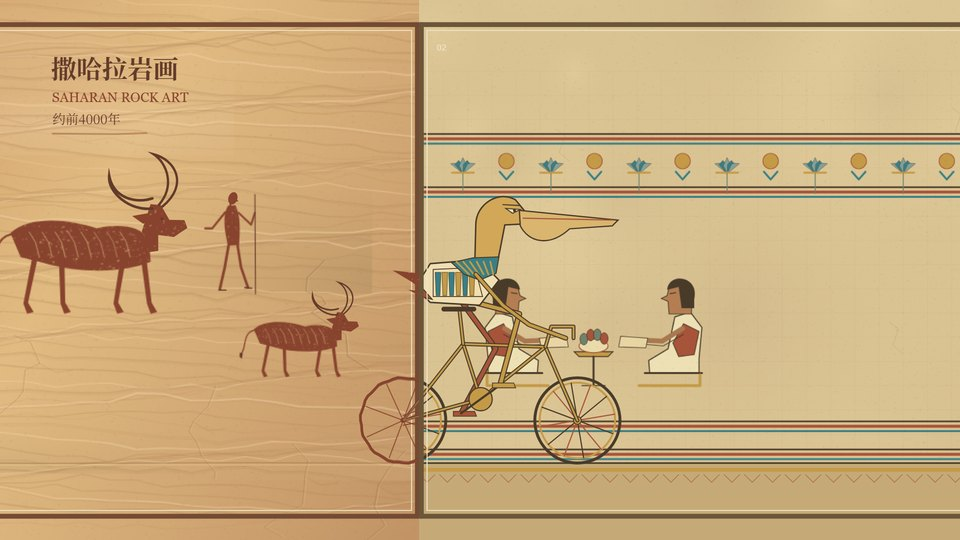
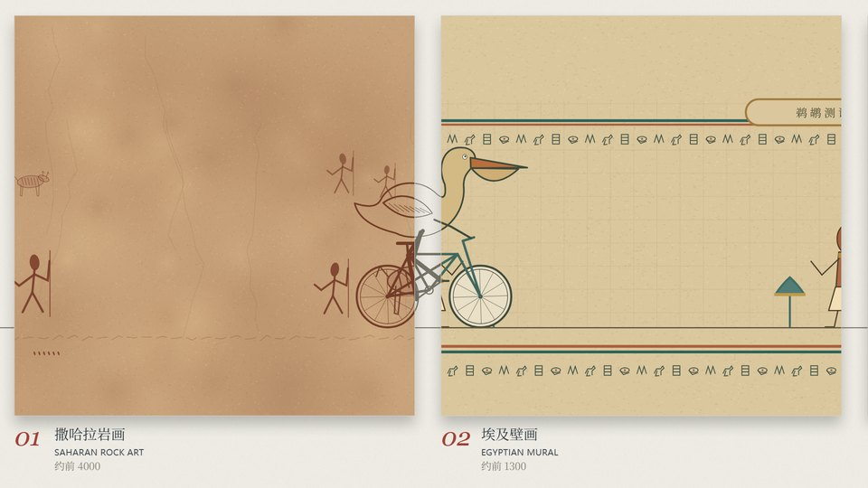
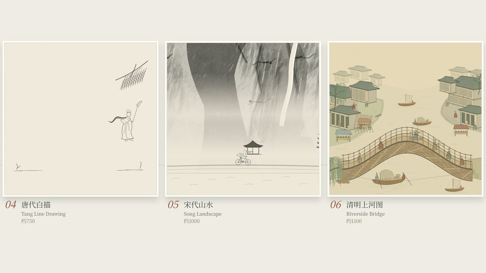
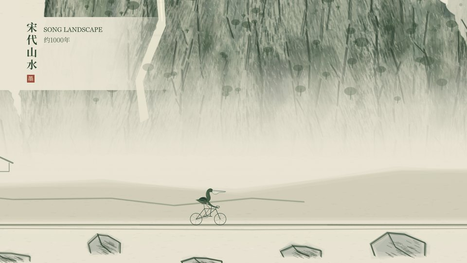
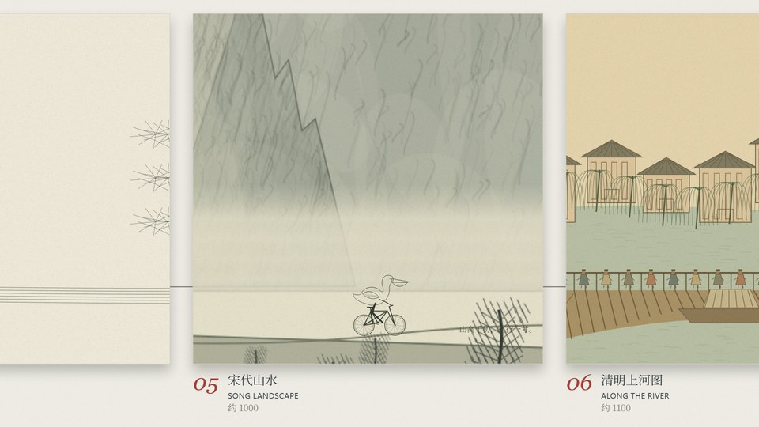
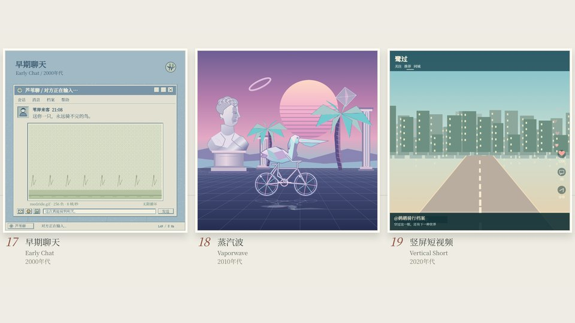
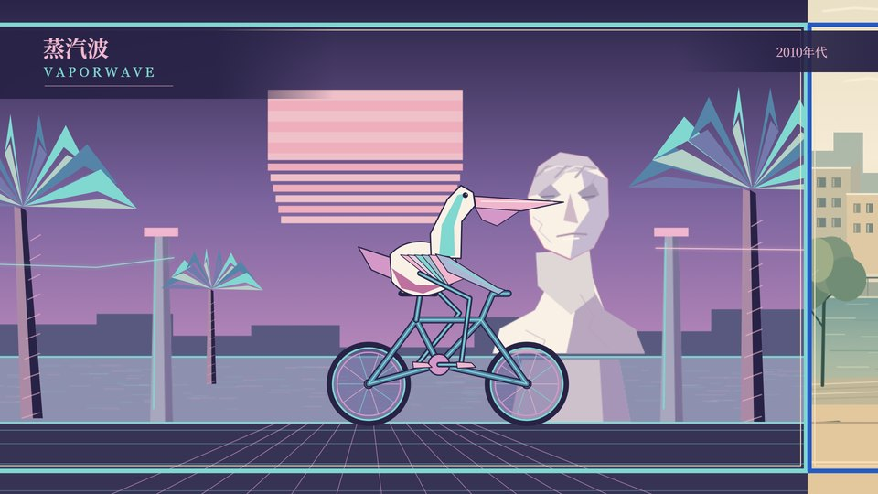
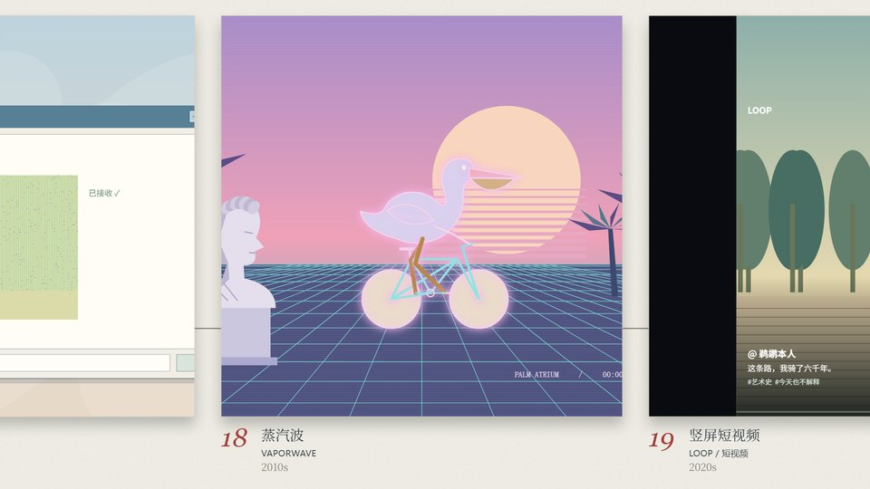

# The Pelican Test — same prompt, three GPT builds

[English](README.md) · [简体中文](README.zh-CN.md)

**One pelican. One bicycle. Twenty eras of art history.** Three independently developed code-animation projects from the same creative brief, collected for visual and source-level comparison.

> “Humanity has always been obsessed with drawing pelicans riding bicycles. Even before the bicycle was invented.”

| Project | Generation setup | Reasoning effort | Approach in this snapshot |
| :--- | :--- | :--- | :--- |
| [pelican-test](pelican-test/) | **GPT 6.1 sol** | **High** | Wide, multi-panel gallery; individually composed era paintings |
| [pelican-test2](pelican-test2/) | **GPT 6.1 sol + Trellis** | **High** | Full-frame scenes, shared cyclist rig, p5.brush material atlas; workflow/spec-guided development |
| [pelican-test3](pelican-test3/) | **GPT 6 Astra** | **High** | Scrolling square gallery; centered rider changes style at each painting boundary |

Model names and effort settings are the project owner's labels. Trellis is a development workflow framework, not an additional image/video model. These are **three configurations involving two named models**, not three distinct base models.

## Visual comparison

Fresh screenshots captured from the source included here, at the same absolute timestamps. The first project's native **1920×840** output is letterboxed; the other two use **1920×1080**. No artwork has been stretched to match another.

### Crossing between paintings · 10.9 s

| GPT 6.1 sol · High | GPT 6.1 sol · High + Trellis | GPT 6 Astra · High |
| :---: | :---: | :---: |
|  |  |  |

### Song landscape · 32 s

| GPT 6.1 sol · High | GPT 6.1 sol · High + Trellis | GPT 6 Astra · High |
| :---: | :---: | :---: |
|  |  |  |

### Vaporwave · 110 s

| GPT 6.1 sol · High | GPT 6.1 sol · High + Trellis | GPT 6 Astra · High |
| :---: | :---: | :---: |
|  |  |  |

The screenshots show visible choices: the first build emphasizes an exhibition of complete paintings; the second gives each scene the screen; the third keeps the rider centered while the exhibition moves. They are observations about these implementations, not quality scores.

## The shared prompt

<details>
<summary><strong>Read the common creative brief (English overview)</strong></summary>

Create a roughly **2:17 procedural animated film** in which a pelican cycles along one continuous road through **20 chronological art styles**, changing its appearance when it crosses a picture frame. Each scene should be carefully finished; humor comes from small, deadpan details.

- **Intro, 5 s:** paper, serif typography and a solemn fictional art-history claim about pelicans cycling before bicycles existed.
- **20 scenes, 6 s each:** Saharan rock art → Egyptian mural → Han stone rubbing → Tang line drawing → Song landscape → *Along the River* → Maya codex → Mughal miniature → Bada Shanren freehand → Javanese shadow puppetry → ukiyo-e → *The Starry Night* → *The Scream* → silent-film shadow study → oscilloscope → 8-bit game → early chat window → vaporwave → vertical short video → code as art.
- **Outro, 12 s:** a 7×3 exhibition wall; 20 finished answers and one empty press-conference seat labeled “Pelican (in person).” The pelican declines comment by cycling past behind the chair; a final bicycle bell remains.
- **Timing:** 120 BPM, 2 seconds per bar; each scene has entrance, comic highlight and exit bars. A pedal revolution lasts two beats. Frame crossings land on downbeats.
- **Engineering:** p5.js, optional p5.brush after license review; deterministic `renderAt(t)`, shared beat/rig/drawing tools, one file per scene, seekable browser preview, Puppeteer frame export and ffmpeg assembly.
- **Sound:** one original theme, procedurally synthesized regional/period-inspired instruments, shared real-time and OfflineAudioContext score; special slowed FM mall-jazz tape processing for vaporwave.
- **Rights:** independent code and scene designs; no reference-film frames, audio, cover art, protected characters, real app brands or copied jokes. Keep third-party notices.
- **Process:** build the skeleton, refine three contrasting styles, complete the other 17 in batches, add music, polish and export. Later user instructions authorized completing all phases and requested gallery-motion revisions.

The [detailed Chinese prompt](docs/PROMPT.zh-CN.md) records the common requirements and scene-specific jokes. Project suffixes are normalized in that document; this repository does not claim byte-identical transcripts of all three chats.

</details>

This is a comparison of **evolved project snapshots**, not a controlled single-shot benchmark. Follow-up feedback, aspect-ratio choices and development workflows differ. No generation-time, token-cost or blind-preference measurements are available. [Method and provenance](docs/COMPARISON.md).

## Run a project

Use **Node.js 20.3+**. Install dependencies inside each project; there is no shared workspace installation. Run one preview at a time because their default port is 4173.

```bash
git clone https://github.com/ShenZiLi/pelican-test-in-GPT.git
cd pelican-test-in-GPT/pelican-test   # or pelican-test2 / pelican-test3
npm ci
npm start                          # pelican-test and pelican-test2
# npm run dev                      # pelican-test3
```

Open **http://127.0.0.1:4173/** for the interactive preview. Play/pause, seek and chapter controls are provided. Audio is synthesized locally; the first synthesis can take time because rendered audio is intentionally absent from this repository.

| Task | pelican-test | pelican-test2 | pelican-test3 |
| :--- | :--- | :--- | :--- |
| Unit checks | `npm test` | `npm test` | `npm test` |
| Browser checks | See project tools | `npm run test:browser` | `npm run check` |
| Synthesize audio | `npm run audio` | `npm run audio` | `npm run audio` |
| Preview | `npm start` | `npm start` | `npm run dev` |
| Rebuild a movie | [Instructions](pelican-test/README.md) | [Instructions](pelican-test2/README.md) | [Instructions](pelican-test3/README.md) |

Movie rebuilding also requires **Chrome, ffmpeg and ffprobe**. The first project uses Puppeteer's browser installation; the other two can use a Puppeteer Chrome cache or `CHROME_PATH`. Follow the per-project README for exact export commands.

## Repository layout

```text
pelican-test/     # GPT 6.1 sol, High
pelican-test2/    # GPT 6.1 sol, High + Trellis
pelican-test3/    # GPT 6 Astra, High
docs/
  images/        # Nine small documentation stills + timestamp manifest
  PROMPT.zh-CN.md
  COMPARISON.md
  provenance.json
```

Each project retains its own source, lockfile, tests, audio synthesizer, drawing briefs and license notices. Selected Trellis workflow/spec documents are preserved in `pelican-test2/.trellis/`; local journals, session traces, agent installations and framework runtime caches are omitted.

**Not included:** `node_modules`, browser binaries, complete videos, WAV masters, frame sequences, export packages, local Git histories, credentials or machine-specific session data. The one generated brush atlas is a runtime material asset, not a film render; rebuild it with `node tools/bake-brush.mjs` inside `pelican-test2` after installing dependencies and Chrome.

## Validation

On the publication snapshot: **53 unit checks passed**, with **2 additional rendered-master checks skipped** because movie/audio outputs are excluded. All three previews loaded for the screenshot capture, nine requested frames rendered without browser script errors. This publication pass does not rerender or re-audit the full soundtracks and movies. See [validation record](docs/COMPARISON.md#validation).

To reproduce the documentation stills after installing all three projects' dependencies and Chrome:

```bash
node docs/capture-comparison.mjs
```

## Credits and rights

Creative direction and model/configuration attribution: the project owner. Inspiration: *Superman in Flight*. The engineering reference [67: An Art History](https://github.com/Tunai-0511/meme67-art-history) informed organization and reproducible rendering; its protected media is not included.

This is a **public source repository**. No blanket license is granted for the original project material by this publication. Third-party components keep their own terms; see each project's `THIRD_PARTY_NOTICES.md` and `licenses/`. Dependencies and system fonts are installed separately. Contributions should identify the project and include relevant checks and before/after screenshots.
