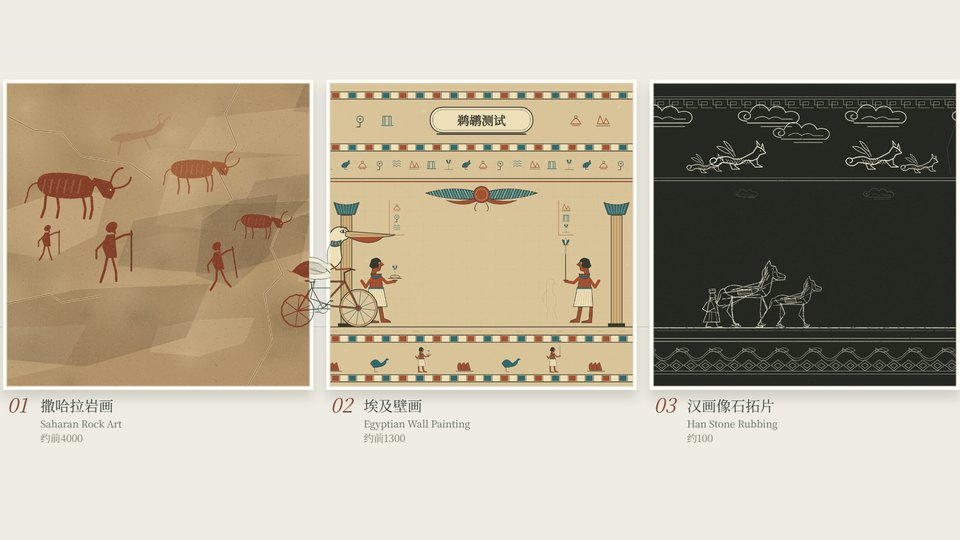
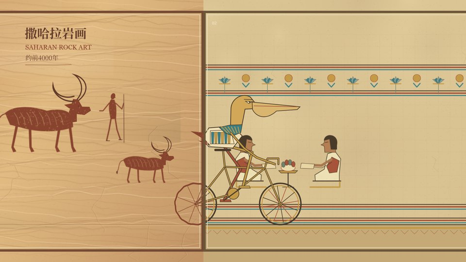
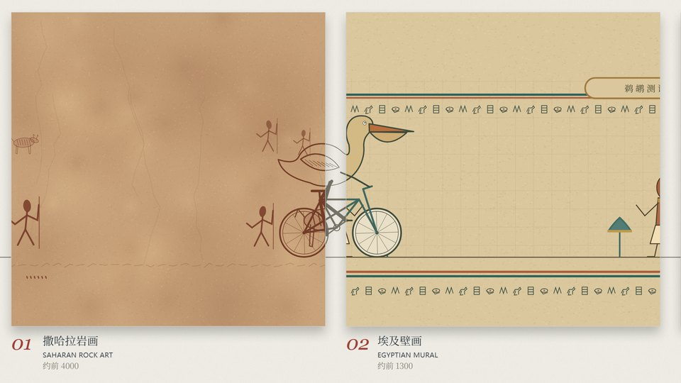
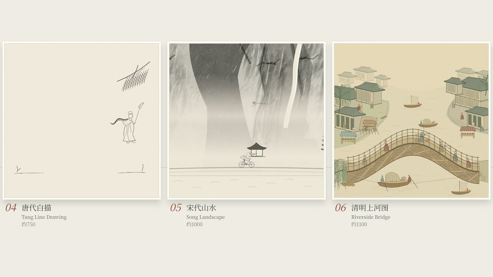
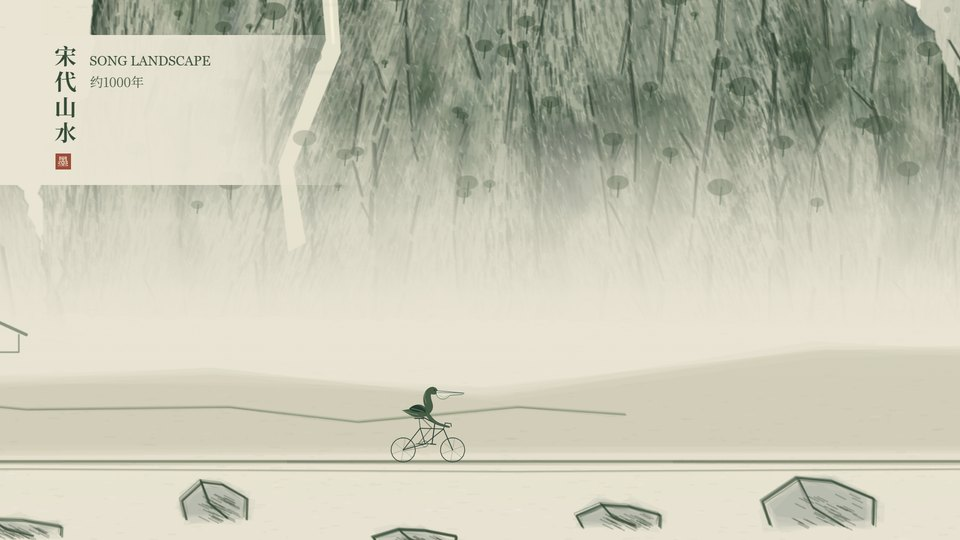
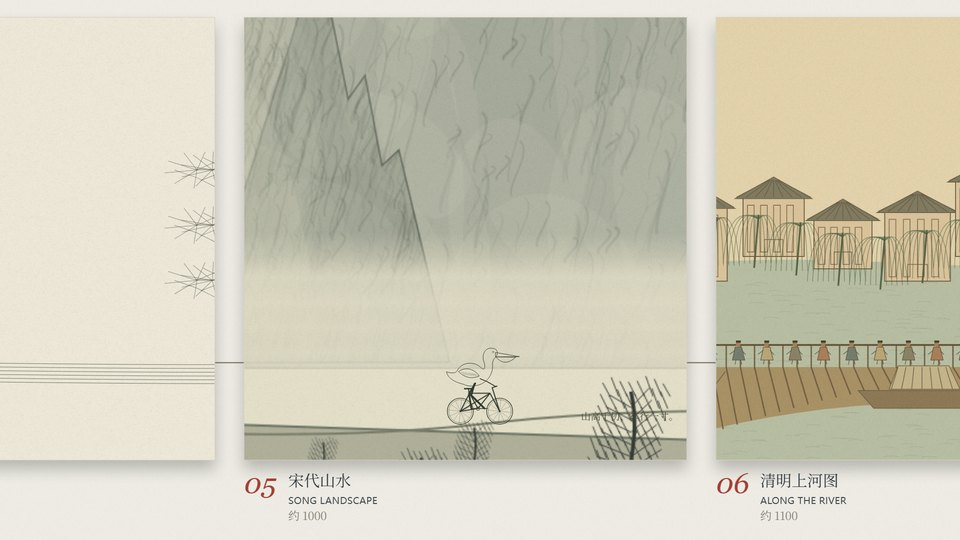
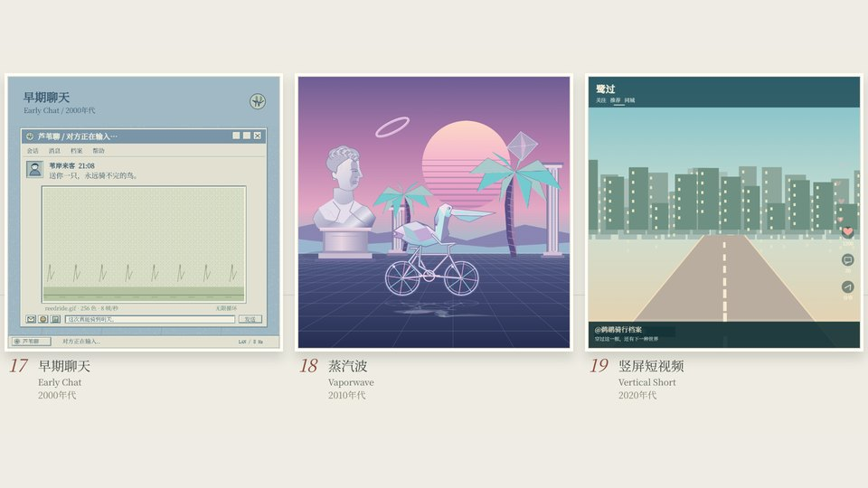
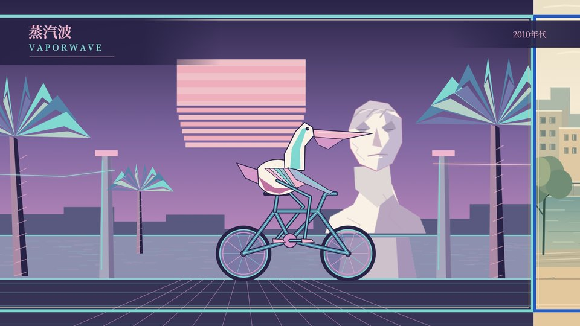
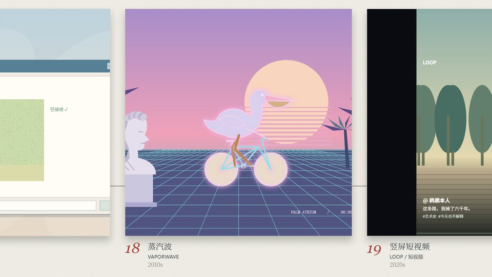

# 鹈鹕测试：相同提示词，三套 GPT 实现

[English](README.md) · [简体中文](README.zh-CN.md)

**一只鹈鹕，一辆自行车，二十个艺术时代。** 本仓库集中展示同一创作任务下独立开发的三个代码动画项目，供画面、工程和实现方法对比。

> 「人类自古以来就痴迷于画鹈鹕骑自行车。」
> 「——早在自行车被发明之前。」

| 项目 | 生成配置 | 推理强度 | 当前实现特点 |
| :--- | :--- | :--- | :--- |
| [pelican-test](pelican-test/) | **GPT 6.1 sol** | **高** | 宽幅展墙、多幅完整作品同屏、各时代独立构图 |
| [pelican-test2](pelican-test2/) | **GPT 6.1 sol + Trellis 框架** | **高** | 全屏场景、共用骑手骨骼、p5.brush 笔触图集、规范与工作流辅助开发 |
| [pelican-test3](pelican-test3/) | **GPT 6 Astra** | **高** | 方形画幅连续横移、居中骑手跨框换画风、画外标题 |

模型名称及推理强度采用项目所有者提供的标注。Trellis 是开发工作流框架，不是额外的图像或视频生成模型；这里比较的是**两个具名模型下的三套配置**。

## 画面对比

以下图片直接从本仓库收录的源码重新截图，采用相同的绝对时间。第一套项目原生画幅为 **1920×840**，展示时补边；另外两套为 **1920×1080**，均未拉伸图像。

### 跨越画框 · 10.9 秒

| GPT 6.1 sol · 高 | GPT 6.1 sol · 高 + Trellis | GPT 6 Astra · 高 |
| :---: | :---: | :---: |
|  |  |  |

### 宋代山水 · 32 秒

| GPT 6.1 sol · 高 | GPT 6.1 sol · 高 + Trellis | GPT 6 Astra · 高 |
| :---: | :---: | :---: |
|  |  |  |

### 蒸汽波 · 110 秒

| GPT 6.1 sol · 高 | GPT 6.1 sol · 高 + Trellis | GPT 6 Astra · 高 |
| :---: | :---: | :---: |
|  |  |  |

从这些快照可以直接看到构图取舍：第一套强调完整画作组成的展览；第二套让每种画风占据整屏；第三套让角色保持居中、展墙从角色身边经过。这些是对当前实现的观察，不是质量评分。

## 相同提示词

<details>
<summary><strong>展开共同创作任务摘要</strong></summary>

制作一支约 **2 分 17 秒**的原创代码动画：鹈鹕骑车沿连续道路穿过 **20 个按年代排列的艺术版块**，每经过画框切换画风。每幕认真完成，笑点来自一本正经的小细节。

- **5 秒 Intro：** 纸张、衬线字、纪录片式庄重音乐与虚构艺术史论断。
- **20 幕各 6 秒：** 撒哈拉岩画、埃及壁画、汉拓片、唐白描、宋山水、清明上河图、玛雅抄本、莫卧儿细密画、八大山人写意、爪哇皮影、浮世绘、星月夜、呐喊、默片影子、示波器、像素游戏、聊天窗口、蒸汽波、竖屏短视频、代码美学。
- **12 秒 Outro：** 7×3 展墙，20 份答卷和一个「鹈鹕（本人）」空席；鹈鹕从席位后方骑过，留下车铃。
- **节奏：** 120 BPM，每小节 2 秒；每幕分进场、笑点、出场三小节；脚踏一圈两拍，穿框落在强拍。
- **工程：** p5.js、可选 p5.brush、确定性的 `renderAt(t)`、共用工具和骨骼、每幕独立文件、可拖动预览、逐帧导出与合成。
- **声音：** 原创主题贯穿，全部程序合成；实时与离线共享乐谱，蒸汽波进行原创 FM 商场爵士磁带降速处理。
- **边界：** 不取用参考影片、音频、封面、渲染帧、角色或具体笑点，现代界面和提示音均为虚构原创。
- **流程：** 骨架、三幕精做、其余 17 幕分批、配乐、打磨导出；后续指令允许完成所有阶段，并提出展墙运动返工。

[详细中文提示词](docs/PROMPT.zh-CN.md)保留共同任务、各幕细节和声音要求，项目名称后缀作统一处理；并不声称三段对话逐字相同。

</details>

这里对比的是**经过后续修改的项目快照**，不是严格控制变量的一次性模型基准。三个项目的反馈过程、画幅选择和工作流存在差异，也没有生成耗时、token 成本或盲测评分数据。详见[对比方法与来源](docs/COMPARISON.md)。

## 本地运行

需要 **Node.js 20.3+**。三个项目分别安装依赖，默认预览端口都是 4173，建议一次启动一个。

```bash
git clone https://github.com/ShenZiLi/pelican-test-in-GPT.git
cd pelican-test-in-GPT/pelican-test   # 或 pelican-test2 / pelican-test3
npm ci
npm start                          # 第一、第二套
# npm run dev                      # 第三套
```

打开 **http://127.0.0.1:4173/**，可播放、暂停、拖动和跳章。仓库不包含渲染好的配乐，首次合成可能需要等待。

| 操作 | pelican-test | pelican-test2 | pelican-test3 |
| :--- | :--- | :--- | :--- |
| 单元检查 | `npm test` | `npm test` | `npm test` |
| 浏览器检查 | 见项目工具 | `npm run test:browser` | `npm run check` |
| 合成配乐 | `npm run audio` | `npm run audio` | `npm run audio` |
| 预览 | `npm start` | `npm start` | `npm run dev` |
| 重建影片 | [步骤](pelican-test/README.md) | [步骤](pelican-test2/README.md) | [步骤](pelican-test3/README.md) |

导出还需要 **Chrome、ffmpeg、ffprobe**。第一套使用 Puppeteer 管理的浏览器；第二、第三套支持 Puppeteer Chrome 缓存或 `CHROME_PATH`。具体命令见各项目说明。

## 收录范围

保留三个独立项目的源码、依赖锁文件、测试、合成器、美术简报与许可声明，以及第二套 `.trellis/` 中选定的规范和工作流文档。`docs/images/` 仅有九张说明用截图和时间点清单，可用 `node docs/capture-comparison.mjs` 重新生成。

**不收录：** 依赖目录、浏览器安装包、完整影片、WAV 母带、逐帧缓存、交付 ZIP、本地 Git 历史、账号凭据及机器会话资料。第二套笔触图集属于运行所需的材质素材，保留一份；在该项目安装依赖和 Chrome 后可用 `node tools/bake-brush.mjs` 重建。Trellis 本地日志、代理安装、运行缓存不随项目发布。

## 验证

发布快照中 **53 项单元检查通过**，另有 **2 项依赖音频母带的检查跳过**。三个预览均成功加载，九张源码截图生成时无浏览器脚本错误。本次源码发布未重新导出或重新审听全部影片和配乐。[详细记录](docs/COMPARISON.md#validation)。

## 致谢与权利

创意方向及模型配置标注来自项目所有者。灵感来自 *Superman in Flight*；工程组织参考 [《67：一部藝術史》](https://github.com/Tunai-0511/meme67-art-history)，未收录其受保护的媒体。

这是一个**公开源码仓库**；本次发布不额外授予原创项目内容统一的开源许可。第三方组件各自遵循原协议，见各项目的 `THIRD_PARTY_NOTICES.md` 与 `licenses/`。依赖与系统字体单独安装。提交改进时请写明对应项目、相关验证和修改前后截图。
