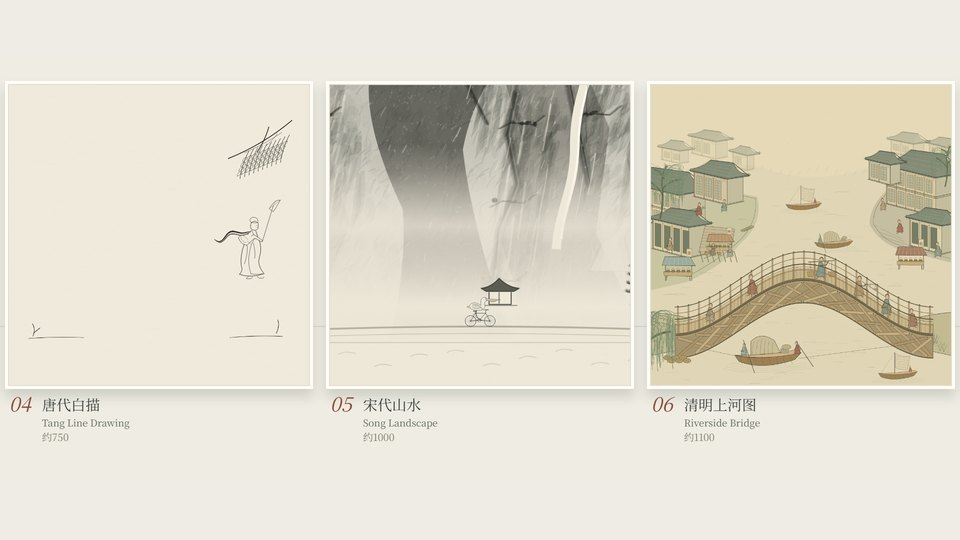

# pelican-test — GPT 6.1 sol (High)

[English](README.md) · [中文制作说明](README.zh-CN.md) · [Three-way comparison](../README.md)

An independent implementation of the 137-second cycling-pelican art-history brief. Generation setup: **GPT 6.1 sol (High)**, attributed by the project owner. This is a source snapshot with later revisions; see [comparison methodology](../docs/COMPARISON.md).



## Preview

Requires Node.js 20.3+. Run these commands inside this project:

```bash
npm ci
npm start
```

Open http://127.0.0.1:4173/. Use playback, seek and chapter controls. Audio is synthesized locally; no rendered soundtrack is shipped. The initial synthesis may be slow. Stop other project servers before using the same port.

## Checks

```bash
npm test
```

Historical delivery reports describe exports made during production. They are not evidence that omitted movie or audio files exist in this checkout. Source-publication checks and their limitations are recorded in the [comparison document](../docs/COMPARISON.md#validation).

## Rebuild the movie

Install Chrome, ffmpeg and ffprobe first. Puppeteer installs its headless browser during npm ci. If installation skipped browser downloads, run npx puppeteer browsers install chrome-headless-shell.

```bash
npm run audio
node tools/render.mjs --from 0 --to 137 --fps 60 --name gallery-v2-final --audio exports/audio/pelican-score.wav
node tools/finalize-v2.mjs
```

All export paths above are generated locally and ignored by Git. Allow time and disk space for frame rendering and audio synthesis. Advanced production notes are in [the Chinese project documentation](README.zh-CN.md).

## Source layout

- `src/`: drawing tools, beat timeline, rider rig, twenty scenes and player.
- `audio/`: original procedural score and synthesis.
- `briefs/`: scene-specific art direction.
- `tests/` and `tools/`: validation, capture, rendering and export utilities.
- `licenses/` and `THIRD_PARTY_NOTICES.md`: third-party notices.


## Rights

Original project material has no blanket license granted by this publication. See [THIRD_PARTY_NOTICES.md](THIRD_PARTY_NOTICES.md) for components with separate licenses. Reference movies, audio, covers, installed dependencies and browser binaries are not included.
